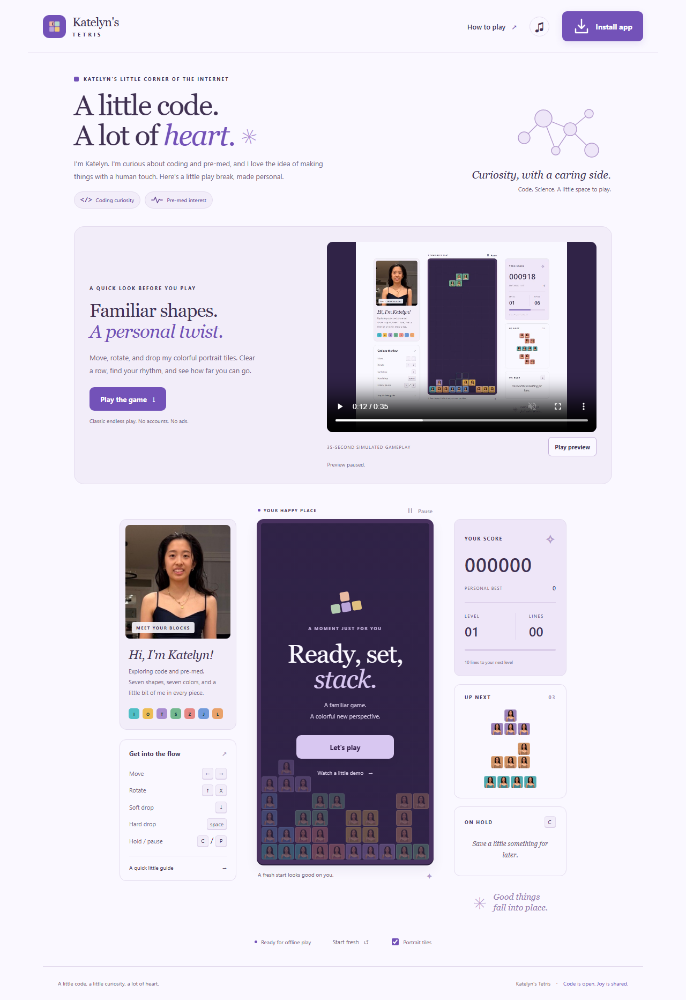

# Katelyn's Tetris

**A little code. A lot of heart.**

A personal portrait-tile **classic endless Tetris** game, built as an installable web app
for iPhone/iPad, Android, and desktop Chrome. No runtime dependencies,
accounts, ads, analytics, or backend.

[Play online](https://katelyncode.github.io/katelynTetris/) ·
[Source on GitHub](https://github.com/katelynCode/katelynTetris)



## Quickstart

Requires **Node.js 22.12+** (Node 24 LTS recommended).

```sh
git clone https://github.com/katelynCode/katelynTetris.git
cd katelynTetris
npm ci
npm start
```

Dependencies use the public npm registry; no private package feed is required.

Open **http://localhost:4173**. Watch the preview, select **Play the game**,
then **Let's play**.
The [illustrated quickstart](public/guide.html) is available at
**http://localhost:4173/guide.html**, including the embedded
[35-second simulated gameplay video](public/media/gameplay.mp4).

Generated portraits, icons, and video are checked in. You do not need the
uncropped original, an image editor, or a video encoder to run or build.
The server listens only on your own computer; use the HTTPS GitHub Pages
deployment below to open/install the game on a phone.

### Play

| Action | Keyboard | Phone |
| --- | --- | --- |
| Move | Left / right arrows | Left / right buttons, or drag sideways |
| Rotate clockwise | Up arrow / X | Rotate button or tap the board |
| Rotate counterclockwise | Z | Use clockwise rotation three times |
| Soft drop | Down arrow | Down button |
| Hard drop | Space | Drop button or swipe down |
| Hold | C / Shift | Hold button |
| Pause / resume | P / Escape | Pause / Keep playing |

Fill a horizontal row to clear it. Clear 10 lines to level up and increase the
fall speed. Pieces keep arriving from shuffled bags of seven: no preset boards
or finite puzzle sequences. A blocked spawn or locking above the board ends
the game. Start fresh resets the board after confirmation.

Hold is available once per falling piece. The ghost outline shows the landing
position. The game uses SRS rotation kicks, a 500ms lock delay, and up to 15
grounded movement/rotation lock resets. Single/double/triple/four-line clears
earn 100/300/500/800 times the current level; soft/hard drops earn 1/2 points
per cell. No T-spin, combo, or back-to-back bonuses are implemented.

Sound starts off. You can switch to solid-color tiles. Your classic personal
best and tile preference stay in this browser; an in-progress game is not
saved on reload. Older puzzle-mode records are left untouched but are no longer
used. The game pauses when the tab/app loses focus. Live simulated play is
available from Watch a little demo or `?demo`; demo scores are never saved.

### Personalized landing page and preview

The lavender/violet landing page introduces Katelyn's coding and pre-med
interests, with subtle molecule/pulse artwork and a prominent install button.
These are personal interests, not a claim of medical credentials, and do not
change the classic gameplay.

The 35-second gameplay video starts automatically **muted and inline** and loops.
It has native controls, a visible Play/Pause preview button, captions, and a
text description. Starting the game pauses the preview. Reduced-motion
preferences disable autoplay; browser autoplay restrictions show a manual
play option. Low-power/data-saving modes may also prevent automatic playback.
A video loading error is reported without blocking the game.

### Install on your device

Use an **HTTPS** deployment (localhost also works for local development):

- **iOS/iPadOS Safari:** Share -> Add to Home Screen -> Add.
- **Android Chrome:** select Install app, or use Chrome's menu ->
  Install app / Add to Home screen.
- **Desktop Chrome:** select Install app or the address-bar install icon.
  Chrome's menu also has an install option; its wording depends on version.

Open online once and wait for **Ready for offline play**. The entire game,
portraits, and guide then work offline. The MP4 and its poster/captions are
not precached; download the video separately or use the offline live demo.
Browser storage eviction or clearing site data can remove offline files and
scores. Installed-app storage and browser storage may be separate on iOS.
This is a PWA, not an App Store/Google Play binary. Real-device installation
should be smoke-tested after deployment.

## Publish on GitHub Pages

1. Confirm photo permissions and review the [photo license](PHOTO-LICENSE.md).
   Do not add the uncropped original to the repository; it is gitignored.
2. Create a GitHub repository and push this project, including the generated
   assets/media and the lockfile. The supplied workflow deploys from `main`.
3. In **Settings -> Pages -> Build and deployment**, choose **GitHub Actions**.
4. Run the **Deploy game to GitHub Pages** workflow (or push to `main`).
5. Open the URL reported by the deployment, typically
   `https://YOUR-USERNAME.github.io/YOUR-REPOSITORY/`.
   This repository's site is `https://katelyncode.github.io/katelynTetris/`.
6. Test the installation flow on a real iPhone and Android device, and share
   that HTTPS URL.

All app, manifest, icon, and service-worker paths are relative, supporting
repository subpaths as well as root domains. No repository or public
deployment is automatically created by this project.

For another static host, run:

```sh
npm run build
```

Publish the **contents of `dist`**. Serve `.webmanifest` as
`application/manifest+json` and `.js` as JavaScript. Do not apply a global
SPA fallback to missing assets. Keep `sw.js` and HTML revalidated, rather
than permanently cached by the host.

## Development and checks

```sh
npm test
npx playwright install chromium webkit
npm run test:browser
npm run build
```

- Pure engine tests cover random bags, queue refills, hold, rotations,
  wall/floor kicks, collisions, scoring, line clears, level progression,
  top-out, and a deterministic classic demo.
- Browser tests cover desktop Chromium, Android-size Chromium, and
  iPhone-size WebKit, including keyboard/touch, offline reload and guide,
  preferences, installation instructions, narrow layouts, gravity, best-score
  persistence, restart confirmation, autoplay playback/fallbacks, reduced
  motion, video errors, and enlarged install-control dimensions.
- WebKit device emulation is not a substitute for real iOS installation tests.
- Browser tests use two workers to limit resource use during video and demo checks.
- During development, unregister the service worker or clear site storage
  after changing app files; the development cache version is fixed.
- Production builds derive the service-worker cache version from file
  contents. Updates wait for all old app windows to close; they do not
  interrupt an active game.

### Regenerate the portrait artwork

Put the authorized original **Image (60).jpg** in the project root, then:

```sh
npm run assets
```

The script makes a 480 x 600 head-and-chest crop named **Katelyn.jpg** and
copies it into the app. Hand-traced masks recolor the dress and background
into seven shape-specific colorways while preserving the face and skin:

| I | O | T | S | Z | J | L |
| --- | --- | --- | --- | --- | --- | --- |
| Teal | Gold | Lavender | Sage | Coral | Blue | Apricot |

Mask coordinates are specific to this supplied photo. A different photo
needs a new crop and masks. No photos are sent to an external service.

### Re-record the demonstration

```sh
npm run demo
```

This launches a temporary server on port 4180, records the real deterministic
classic demo with Playwright, crops the gameplay area into a 35-second
1000 x 900 H.264 MP4 using the
development-only `ffmpeg-static` executable. It also makes the preview and
video poster. The script verifies that the simulation actually clears rows,
then shuts down its browser/server and removes the temporary recording.
The video is silent and has descriptive captions and a text alternative.
FFmpeg is not shipped in the deployed app; it retains its upstream license.

## Project map

- `public/engine.js` - classic game rules and simulated-player heuristic.
- `public/app.js` - canvas rendering, controls, sound, and game lifecycle.
- `public/landing.js` - muted video autoplay, controls, reduced-motion handling,
  and explicit media-error/autoplay-blocked fallbacks.
- `public/pwa.js`, `public/sw.js`, `public/manifest.webmanifest` - installation
  and versioned offline cache.
- `public/guide.html` - in-app quickstart, install help, and video.
- `public/assets/` - portraits and app icons.
- `public/media/` - gameplay recording, captions, poster, and preview.
- `scripts/` - local server, build, artwork, and recording scripts.
- `tests/` - engine and browser tests.

## Accessibility and privacy

Keyboard and touch controls, visible focus rings, labeled buttons, semantic
dialogs, reduced-motion support, and live announcements are provided.
Because the board is a visual canvas, the game is not fully playable
nonvisually. There is no network score collection, analytics, external
font service, or tracking. Classic play stores the best score and portrait
preference. It does not delete older puzzle-mode records if present.

## Licensing and naming

**Code, documentation text, and geometric icons:** [MIT](LICENSE).

**Photos and photo-containing media:** [game-only redistribution terms](PHOTO-LICENSE.md).
These assets may travel with this game and its modified versions and
documentation, but may not be redistributed as standalone assets or used
in unrelated projects. The combined repository is **not entirely MIT-licensed**.
For an entirely MIT-licensed fork, replace all photo assets and derived media.

Before publication, confirm the photographer/copyright owner's permission
and the depicted person's consent. The supplied license does not establish
those rights on its own.

This is an independent personal project, not affiliated with or endorsed by
The Tetris Company. Tetris is a trademark of its respective owners. Neither
license grants trademark rights; review the name before public or commercial
distribution.
